# 📦 AMR–협동로봇 연계 택배 분류 자동화 및 실시간 관제 시스템

<p align="center">
  
  
  
  
  
  
  
  
  
  
</p>

<p align="center"><b>Isaac Sim 5.1 + ROS 2 Jazzy 기반 End-to-End 물류 자동화 Digital Twin</b><br>IW Hub AMR · Doosan P3020 · VGP20 · RGB-D Vision · Conveyor · Wheel Sorter · Nav2 · MQTT · FastAPI · PostgreSQL · React</p>

택배가 담긴 **Cargo Pod를 IW Hub AMR이 운반**하고, **P3020 IN이 RGB-D + YOLO로 박스를 인식해 Conveyor에 올리면**, **Wheel Sorter가 지역별로 분류**하고 Reject Line의 박스는 **P3020 OUT이 Reject Bin에 적재**합니다. 전 과정을 **Isaac Sim 5.1 + ROS 2 Jazzy 디지털 트윈**에서 하나의 미션으로 연결하고, **React Control Tower**에서 실시간으로 관제합니다.

> 두산 로보틱스 ROKEY Boot Camp 9기 · 협동-3 · C2조 **4명** — 정의석(팀장) · 정동휘 · 황인재 · 서진우 · 2026.08.14 ~ 08.28

<p align="center">
  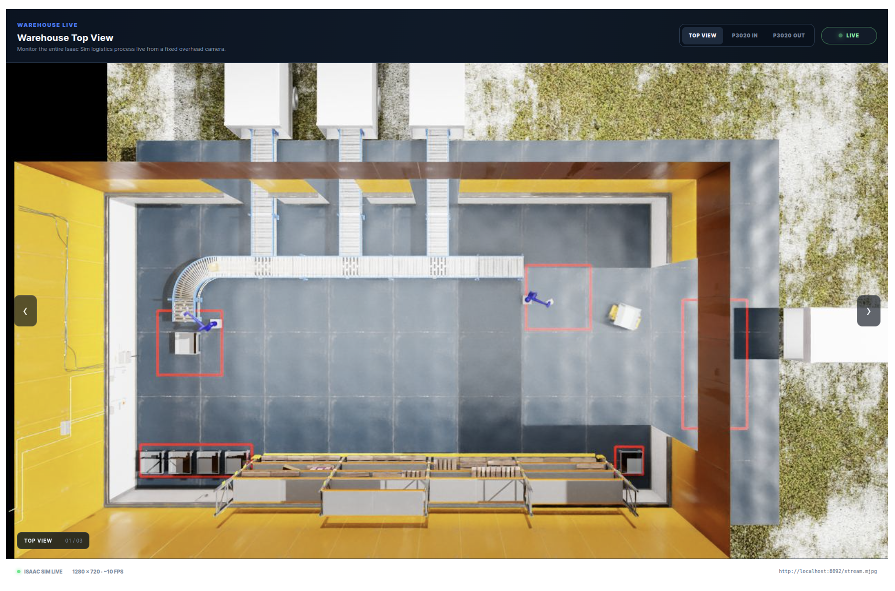<br>
  <sub>AMR 운반 → P3020 Pick & Place → Conveyor 이송 → Wheel Sorter 분류 → Control Tower 관제를 하나의 시나리오로 연결</sub>
</p>

> [!NOTE]
> Isaac Sim 시뮬레이션 기반입니다. 설치 및 실행은 `ROS_DOMAIN_ID=110`, `RMW_IMPLEMENTATION=rmw_fastrtps_cpp` 기준입니다.

## 🎬 데모

<p align="center">
  <a href="docs/screenshots/isaac-sim-record-x5.gif">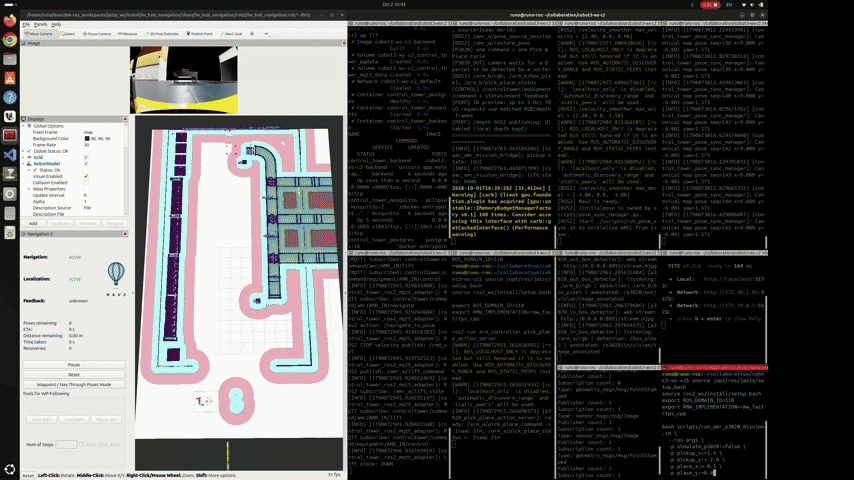</a><br>
  <sub><b>Warehouse Simulation · 5×</b> — AMR · P3020 · Conveyor가 연동되는 전체 시뮬레이션</sub>
</p>

<table>
  <tr>
    <td width="50%" align="center"><a href="docs/screenshots/top-view-x5.gif">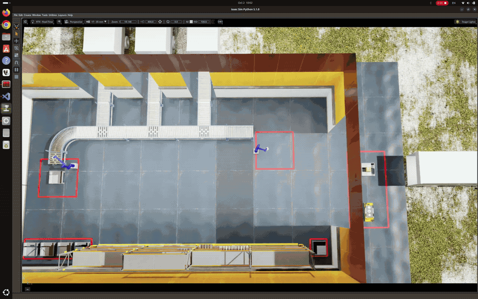</a><br><sub><b>Warehouse Top View · 5×</b> — 상단 카메라로 본 전체 공정</sub></td>
    <td width="50%" align="center"><a href="docs/screenshots/rviz2-and-terminal-x10.gif"></a><br><sub><b>RViz2 + Terminal · 10×</b> — Nav2 주행 화면과 실행 로그</sub></td>
  </tr>
</table>

기능별 GIF는 아래 [✨ 핵심 기능](#-핵심-기능)에 있습니다. GIF를 누르면 원본 파일이 열립니다.

## 💡 한눈에

| 구분 | 구현 내용 |
|---|---|
| **AMR 운반** | IW Hub가 Cargo Pod에 도킹 → Lift Up → Nav2 자율주행 → P3020 작업 위치 이동 → 작업 후 원위치 복귀 |
| **Vision + P3020 IN** | YOLO ONNX + RGB/Depth로 박스를 검출하고 3D 좌표를 계산해 반복 Pick & Place 수행 |
| **Conveyor + Sorter** | Main Conveyor 이송 후 `box_id`에 따라 Region A/B/C 또는 Reject Line으로 분기 |
| **P3020 OUT** | Reject Line에 도착한 박스를 검출해 Reject Bin으로 Pick & Place |
| **Control Tower** | 공정 상태, 처리 내역, AMR 상태/수동 제어, Warehouse 및 로봇 카메라 스트림 제공 |
| **Integration** | ROS 2 ↔ MQTT Adapter ↔ Mosquitto ↔ FastAPI ↔ PostgreSQL ↔ React 연결 |

```text
START → Cargo 도킹 · Lift Up → Nav2 이동 → 정밀 도킹 · Cargo 하강 → P3020 IN 반복 Pick & Place → CARGO_EMPTY → Cargo 원위치 복귀 → Spawn 복귀 → END
                                                         └ PACKAGE_ENTERED → Main Conveyor → Wheel Sorter → Region A/B/C 또는 Reject Line → P3020 OUT → Reject Bin
```

## ✨ 핵심 기능

### 🚛 AMR 운반 — Nav2 자율주행 · 정밀 도킹
IW Hub가 Cargo Pod에 도킹해 Lift Up한 뒤 **Nav2(AMCL)로 P3020 작업 위치까지 이동**하고, P3020 작업이 끝나면 빈 Cargo를 원위치에 내려놓고 Spawn으로 돌아옵니다. Control Tower에서 카메라와 상태를 보며 수동으로 움직일 수도 있습니다.

<p align="center">
  <a href="docs/screenshots/manual-move-x3.gif">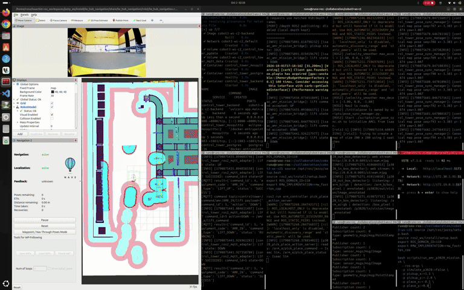</a><br>
  <sub><b>AMR Manual Control · 3×</b> — Control Tower에서 카메라와 상태를 보며 AMR 수동 이동 제어</sub>
</p>

<details>
<summary>자세히 — 코드 · 지도</summary>

```text
isaac_sim/robots/iw_hub/iw_hub_mission_agent.py
scripts/run_amr_p3020_mission.sh
```

Nav2 map:

```text
isaac_sim/usd/parcel_sorting_map/navigation/maps/parcel_sorting_map.yaml
```

</details>

### 🦾 Vision + P3020 IN — 박스를 찾아 반복 Pick & Place
P3020 IN·OUT의 RGB/Depth 카메라와 YOLO 결과를 이용해 Pick & Place 대상을 검출합니다. `TARGET LOCKED` 상태에서는 초록색 테두리, 중앙 조준점, 검출 신뢰도를 함께 표시합니다. 박스 검출 모델의 학습과 ONNX 변환 과정은 아래 '자세히'에 있습니다.

<table>
  <tr>
    <td width="50%" align="center">
      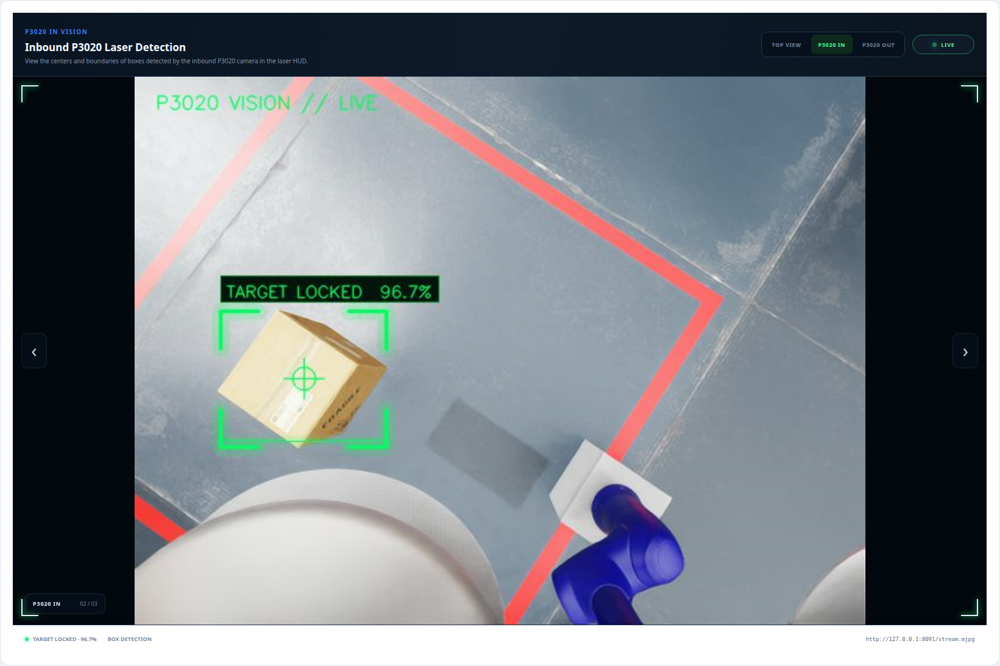
      <br><sub><b>P3020 IN</b> — Cargo Pod 박스 검출 / Target Lock</sub>
    </td>
    <td width="50%" align="center">
      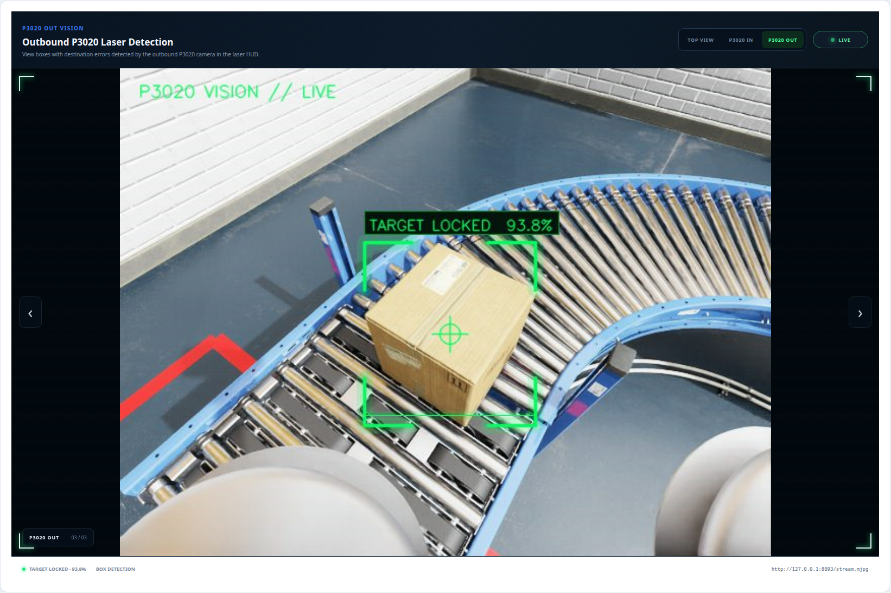
      <br><sub><b>P3020 OUT</b> — Reject Line 박스 검출 / Target Lock</sub>
    </td>
  </tr>
</table>

<details>
<summary>자세히 — Pick & Place 코드 · Action Server · YOLO 학습과 ONNX 변환 · 탐색 화면</summary>

**P3020 IN Pick & Place / Joint / Gripper 제어**

```text
isaac_sim/robots/p3020/p3020_mission_agent.py
```

- P3020 관절 동작
- VGP20 grasp / release
- RGB/Depth 기반 박스 접근
- Pick & Place 상태 관리

**ROS 2 P3020 Action Server**

```text
ros2_ws/src/arm_controller/arm_controller/pick_place_action_server.py
```

Action:

```text
/p3020/pick_place
```

**Vision**

```text
isaac_sim/robots/p3020/vision/box_detector_node.py
isaac_sim/robots/p3020/vision/object_detector.py
models/parcel_box_yolo_model/best.onnx
```

#### YOLO 박스 검출 모델 학습 · ONNX 변환

| 단계 | 파일 | 내용 |
|---|---|---|
| 1. 합성 데이터 생성 | `isaac_sim/scripts/generate_parcel_data.py` | Isaac Sim Replicator로 손목 카메라 시점에서 AMR 위·Conveyor 위 택배 박스를 여러 각도와 거리로 촬영하고 RGB와 2D bbox(`bounding_box_2d_tight`)를 저장 |
| 2. YOLO 형식 변환 | `isaac_sim/scripts/convert_to_yolo.py` | Replicator 출력을 YOLOv8 데이터셋(images·labels train/val, `data.yaml`)으로 변환. 기본 검증 비율 20%, 시스템 `python3`로 실행 |
| 3. 학습 · 평가 | `isaac_sim/scripts/train_yolo_colab.ipynb` | Google Colab에서 `yolov8n.pt` 파인튜닝(1 class `box`, epochs 100, imgsz 640, batch 16) 후 mAP · Precision · Recall 평가 |
| 4. ONNX 변환 | 같은 노트북 | `model.export(format="onnx", opset=12, simplify=True)` → `models/parcel_box_yolo_model/best.onnx` |
| 5. 추론 | `object_detector.py`, `box_detector_node.py` | 시스템 Python `.venv`의 ONNX Runtime으로 640×640 letterbox 추론, 가장 신뢰도 높은 박스 중심을 `/box_pixel`로 발행 |

**ONNX를 쓴 이유** — Isaac Sim은 내장 Python 3.11을, ROS 2 Jazzy는 시스템 Python 3.12를 사용해 패키지를 함께 쓸 수 없습니다. 그래서 박스 검출은 Isaac Sim 밖의 별도 프로세스에서 실행하고, 그 환경에는 PyTorch · Ultralytics 없이 `onnxruntime`만 설치하면 되도록(`requirements/vision.txt`, `scripts/setup_vision_env.sh`) 학습한 모델을 ONNX로 변환해 사용합니다. 카메라 2대를 CPU에서 동시에 추론하므로 ONNX Runtime 스레드 수를 제한해 두었습니다(`object_detector.py`).

<details>
<summary><b>SCANNING / WAITING 상태 화면 보기</b></summary>
<br>

| P3020 IN · SCANNING | P3020 OUT · SCANNING |
|---|---|
| 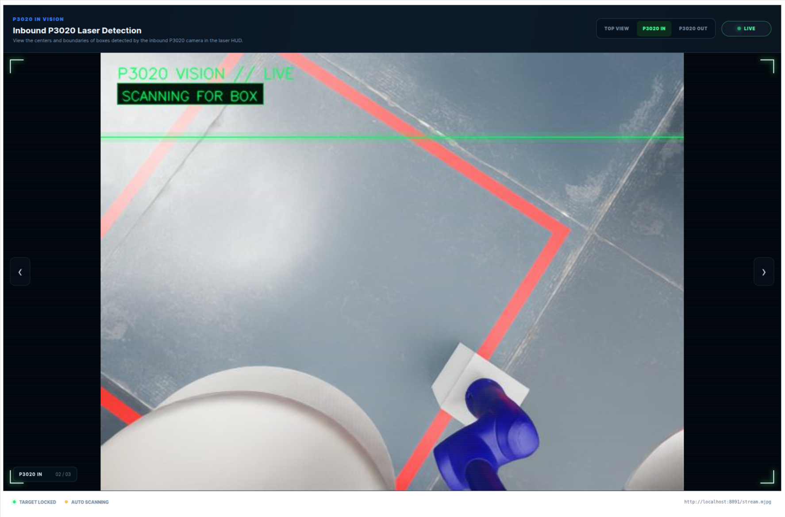 | 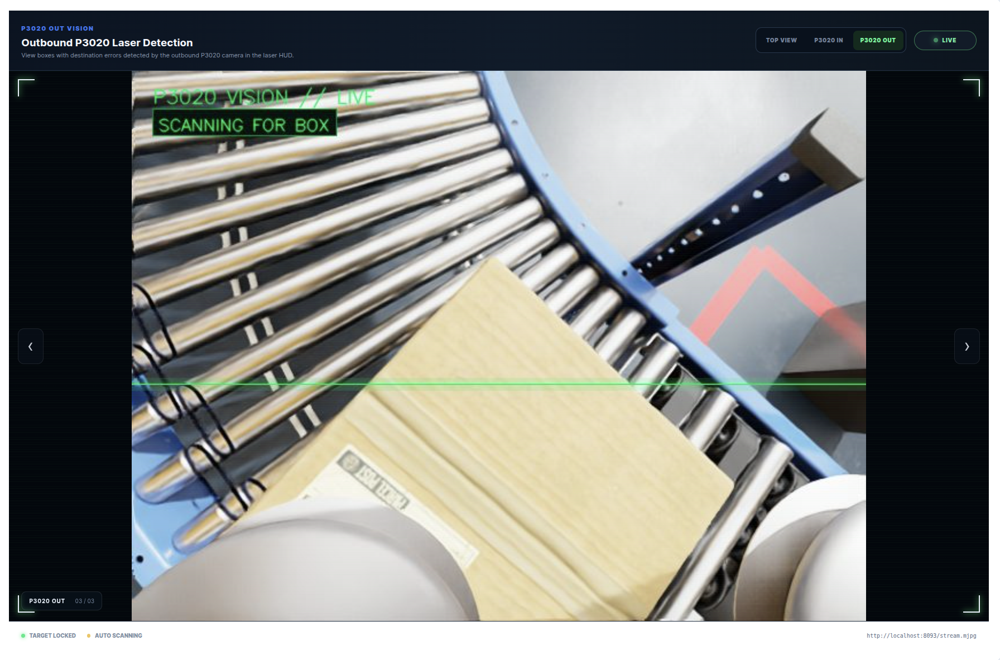 |

<p align="center">
  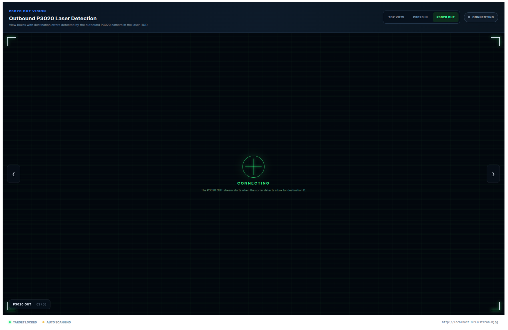
  <br><sub>P3020 OUT 카메라 대기 화면</sub>
</p>

</details>

</details>

### 🔀 Conveyor + Wheel Sorter — 지역별 자동 분류
Main Conveyor가 박스를 이송하면 Wheel Sorter가 `box_id`에 따라 **Region A/B/C 또는 Reject Line**으로 나눕니다.

<p align="center">
  <a href="docs/screenshots/sorter.gif"></a><br>
  <sub><b>Wheel Sorter · Parcel Sorting</b> — Conveyor Parcel을 목적지에 따라 자동 분류</sub>
</p>

<details>
<summary>자세히 — 코드</summary>

```text
isaac_sim/equipment/conveyor/conveyor_controller.py
isaac_sim/equipment/wheel_sorter/wheel_sorter_controller.py
```

제어 방식은 [docs/conveyor_sorter_control.md](docs/conveyor_sorter_control.md)에 있습니다.

</details>

### ♻️ P3020 OUT — Reject Bin 적재
Reject Line에 도착한 박스를 P3020 OUT이 **비전으로 다시 검출해 Reject Bin에 Pick & Place**합니다. Reject Bin에 빈 칸이 없으면 `BIN_FULL`로 알립니다.

<p align="center">
  <a href="docs/screenshots/p3020-out-box-detecting.gif"></a><br>
  <sub><b>P3020 OUT · Box Detection</b> — Reject Line 박스를 비전으로 검출해 작업 대상을 확인</sub>
</p>

<details>
<summary>자세히 — 코드</summary>

```text
isaac_sim/robots/p3020/p3020_out_mission_agent.py
```

</details>

### 🖥️ Control Tower — 실시간 관제
웹에서 **공정 상태 · 처리 내역 · AMR 상태와 수동 제어 · Warehouse 및 로봇 카메라 스트림**을 봅니다. ROS 2와 웹은 MQTT Adapter로 이어집니다.

<table>
  <tr>
    <td width="50%" align="center">
      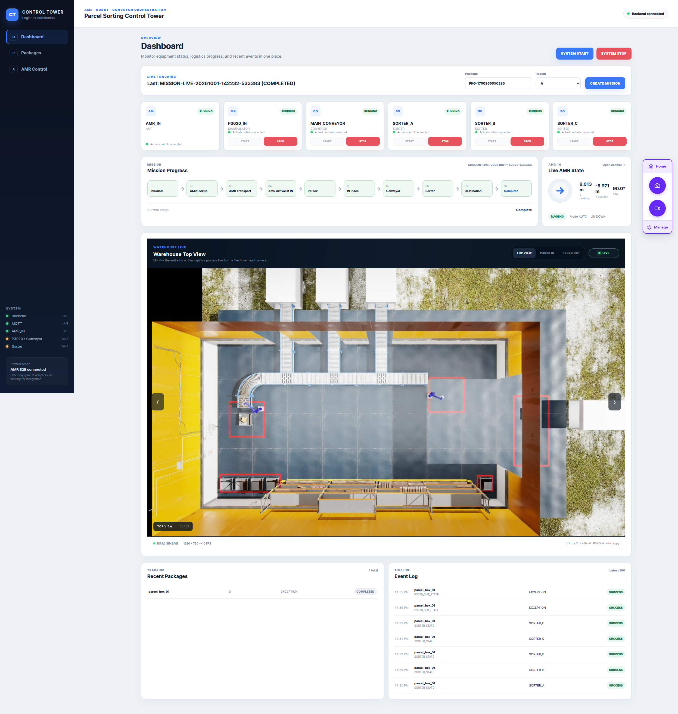
      <br><sub><b>Dashboard</b> — 공정 상태 + Warehouse 실시간 화면</sub>
    </td>
    <td width="50%" align="center">
      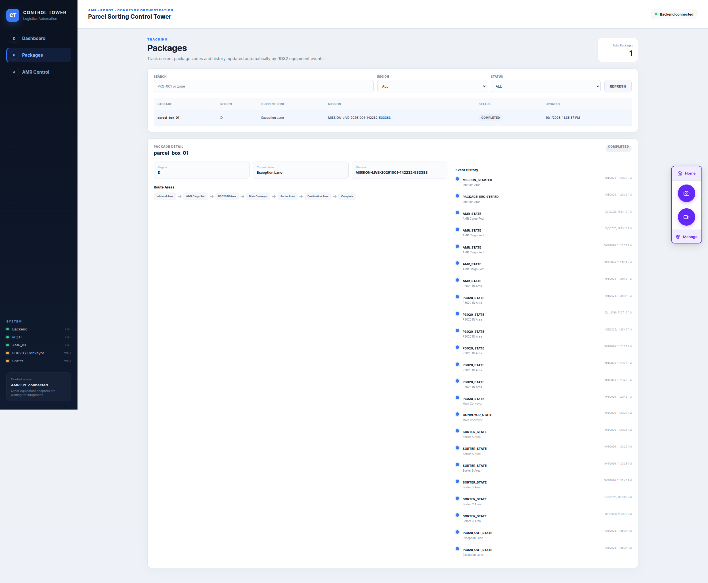
      <br><sub><b>Tracking</b> — 조건 검색 + 택배 처리 내역</sub>
    </td>
  </tr>
</table>

<p align="center">
  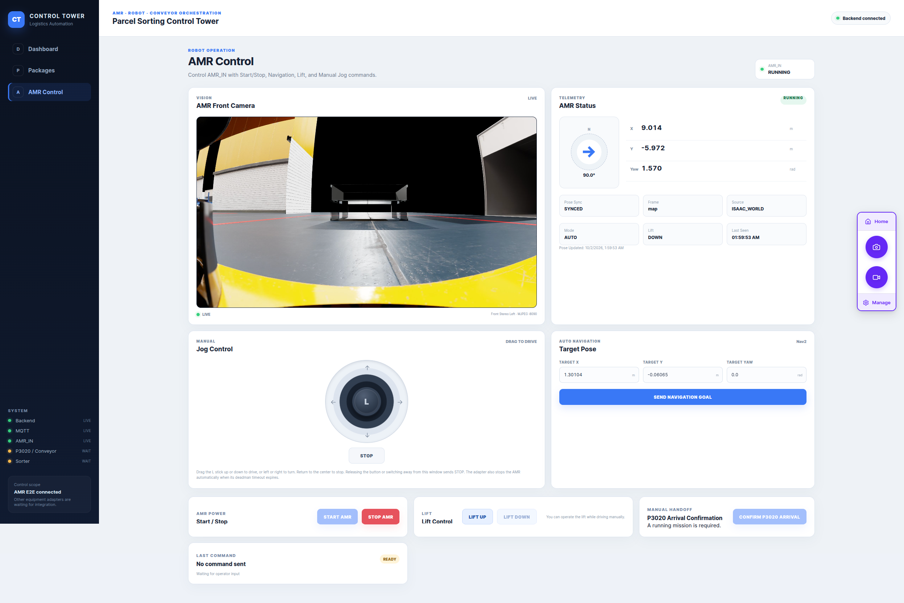
  <br><sub><b>AMR Control</b> — 카메라 · 상태 · Manual Move · Lift 제어</sub>
</p>

## 🛠️ 시스템 구조

> **[Archify 아키텍처 뷰어 열기](https://cobot3-ws-c2-architectures.netlify.app/)** — 시스템 아키텍처, ROS 2 통신 아키텍처, 플로우차트, ERD를 로그인 없이 확인할 수 있습니다. 아래 그림을 클릭하면 뷰어로 이동하며, 메뉴에서 각 다이어그램을 선택해 검색·경로 탐색·확대 및 내보내기를 사용할 수 있습니다.

### 시스템 아키텍처 · System Architecture

React Control Tower부터 FastAPI·PostgreSQL·MQTT, Host ROS 2, Isaac Sim까지 전체 구성 요소와 연결을 보여줍니다. Web / Host ROS 2 / Isaac Sim은 논리적 실행 영역이며, 물리 PC 세 대를 의미하지 않습니다.

<p align="center">
  <a href="https://cobot3-ws-c2-architectures.netlify.app/">
    
  </a>
</p>

**데이터 흐름**

- **관제·제어**: React ↔ FastAPI ↔ Mosquitto ↔ ROS 2 MQTT Adapter ↔ 로봇·공정 실행
- **AMR Mission**: Cargo 도킹·Lift → Nav2 이동 → P3020 작업 → Cargo 및 Spawn 복귀
- **Vision·P3020**: RGB/Depth 기반 박스 검출과 Pick & Place 명령·상태 연결
- **실시간 영상**: 카메라 이미지 → MJPEG Stream → React Control Tower

### ROS 2 통신 아키텍처 · ROS 2 Communication Architecture

ROS 2 노드 사이의 토픽·액션과 Isaac Sim 프로세스 내부 연결을 구분합니다. 명령·피드백 방향, Nav2·Lift·Vision·P3020·MQTT Adapter의 연결을 확인할 수 있습니다.

<p align="center">
  <a href="https://cobot3-ws-c2-architectures.netlify.app/">
    
  </a>
</p>

### ERD · 데이터 구조

장비·상태·명령, 구역, Mission·진행 단계, 택배·처리 이력을 저장하는 **8개 테이블과 7개 관계**입니다. 컬럼과 PK·FK·UK, 관계의 수를 함께 표시합니다.

<p align="center">
  <a href="https://cobot3-ws-c2-architectures.netlify.app/">
    
  </a>
</p>

### 전체 Flow Chart

AMR 운반 → P3020 IN 작업 → Conveyor·Sorter 분류 / AMR 복귀 순서로 공정을 보여줍니다. **START는 맨 위, END는 맨 아래**에 배치했으며, 대기·오류·Reject Bin 분기와 분류 / AMR 복귀의 병렬 흐름을 포함합니다.

<p align="center">
  <a href="https://cobot3-ws-c2-architectures.netlify.app/">
    
  </a>
</p>

#### 핵심 Mission 흐름

`START → Cargo 도킹·Lift Up → PICKUP_DONE → Nav2 이동 → 정밀 도킹·Cargo 하강 → P3020 반복 Pick & Place → CARGO_EMPTY → 빈 Cargo Lift Up → Cargo 위치 복귀·정밀 도킹 → Lift Down·Pose 검증 → Spawn 복귀 → END`

- **공정 분류**: `PACKAGE_ENTERED → Main Conveyor → box_id → Region A/B/C 또는 Reject Line → P3020 OUT → Reject Bin`
- **오류 분기**: Nav2 실패, 비전 응답 오류, `DONE_FAIL`은 `MISSION ERROR`로 연결됩니다. Reject Bin에 빈 Slot이 없으면 `BIN_FULL`로 분기합니다.
- **실행 조건**: PickPlace Action을 사용하는 `simulate_p3020=false` 기준입니다.

[전체 다이어그램을 Archify 뷰어에서 살펴보기](https://cobot3-ws-c2-architectures.netlify.app/)

## 🧩 기술적 도전 · 해결

Isaac Sim 내장 Python과 시스템 ROS 2의 경계, 시뮬레이션 좌표와 동선처럼 통합 단계에서 드러난 문제를 하나씩 고쳤습니다.

| 문제 | 원인 → 해결 | 결과 |
|---|---|---|
| Isaac Sim 안에서 커스텀 액션 서버(`PickPlace`)를 만들면 `Type support not from this implementation` 오류 | Isaac Sim 내장 Python 3.11과 시스템 ROS 2(Python 3.12)의 타입 지원이 맞지 않음 → 액션 서버를 시스템 Python 프로세스로 분리하고, Isaac Sim과는 표준 타입(`std_msgs/String` JSON 토픽 2개)으로만 연결 | goal 수락 · feedback 정상 |
| 이송 중 박스가 벽 · 컨베이어에 걸림 | 이송 높이를 그리퍼 기준으로 잡아 박스는 0.31 m 아래로 지나감 → 박스 바닥 기준 최소 이송 높이로 변경 | 충돌 사라짐 |
| 박스 1개만 옮기고 AMR이 복귀함 | 박스 하나의 `DONE_SUCCESS`를 액션 종료로 처리 → 박스 단위 피드백과 종료 신호(`CARGO_EMPTY`)를 분리 | 화물이 빌 때까지 연속 처리 |
| 맵을 고칠 때마다 하드코딩한 로봇 좌표가 깨짐 | 실행 시 USD prim의 world transform에서 로봇 베이스 pose를 직접 읽어 IK에 반영 | 맵이 바뀌어도 다시 잴 필요 없음 |
| 노란 AMR 몸체가 박스 색 조건을 통과해 오검출 | 색상 대신 높이(world Z) 기준으로 오검출을 거름 | 박스만 작업 대상으로 남음 |

## 📊 결과

- 입고 AMR 운반 → P3020 IN 반복 Pick & Place → Conveyor → Wheel Sorter 분류 → P3020 OUT Reject Bin 적재까지 **전 공정을 한 미션으로 연결**했습니다(위 시연 GIF).
- 박스 수를 미리 정하지 않고, 화물이 빌 때까지(5초 동안 미검출 → `CARGO_EMPTY`) 반복 처리한 뒤 AMR 복귀를 요청합니다.
- Control Tower에서 공정 상태 · 처리 내역 · AMR 상태 · 카메라 스트림을 실시간으로 확인합니다.

## 🌱 배운 점 · 한계

**배운 점**

- Isaac Sim 내장 Python과 시스템 ROS 2 사이의 런타임 경계, 시뮬레이션 좌표계와 실측 Depth의 차이처럼 **실제 통합 단계에서만 드러나는 문제를 디지털 트윈으로 미리 발견**할 수 있었습니다.
- 비전 좌표 · 자율주행 · Pick & Place · 컨베이어를 **개별로 검증한 뒤 통합**하고, 비전과 로봇팔의 책임을 ROS 2 인터페이스로 나눠 역할별로 병렬 개발했습니다.

**한계**

- Isaac Sim 시뮬레이션에서만 검증했고 실제 장비로는 하지 않았습니다.
- 세부 사항을 충분히 고려하지 못했고, PC 사양(GPU 리소스)을 고려하지 않고 계획해 리소스가 부족했습니다.

## 👥 팀 · 역할

| 이름 | 역할 | 맡은 것 |
|---|---|---|
| 정의석 | 팀장 | 입고 AMR 운행 구현, 전체 Flow 관제 시스템(Control Tower) 제작 |
| 정동휘 | 팀원 | Isaac Sim 공정 환경 구축, Conveyor & Wheel Sorter 구현 |
| 황인재 | 팀원 | P3020 Pick & Place 구현, 입고 Camera Vision 인식 + Pick & Place 연동 |
| 서진우 | 팀원 | YOLO & numpy 박스 인식 모듈 구현, 상자 적재 알고리즘 |

## 🤝 개발 · 협업 방식

- **역할별 개발 · 통합:** 비전 좌표 · 자율주행 · Pick & Place · 컨베이어를 각자 개별 검증한 뒤 하나의 미션으로 통합했습니다.
- **인터페이스로 책임 분리:** `LocateBox` · `ConfirmGrasp` · `PickPlace` 등 ROS 2 인터페이스로 비전과 로봇팔의 책임을 나눴습니다.
- **기록:** GitHub에서 역할별 코드와 문서를 브랜치 · 커밋 단위로 관리하고, Notion에 요구사항 · 진행 상황 · 발표 자료 · 기술 내용을 정리했습니다.

## 💻 개발 환경 · 장비

<details>
<summary>운영체제 · 버전 · 장비 · 시뮬레이션 Asset · ROS 2 패키지</summary>

| 항목 | 버전 / 설정 |
|---|---|
| OS | Ubuntu 24.04 |
| NVIDIA Isaac Sim | 5.1.0 |
| ROS 2 | Jazzy |
| Python (Host / ROS2) | 3.12 |
| Python (Isaac Sim Embedded) | 3.11 |
| ROS Domain | `ROS_DOMAIN_ID=110` |
| RMW | `rmw_fastrtps_cpp` |
| Navigation | Nav2 / AMCL |
| Simulation | USD / PhysX / OmniGraph |
| Vision | OpenCV / ONNX Runtime / YOLO model |
| Backend | FastAPI |
| Message Broker | Eclipse Mosquitto MQTT |
| Database | PostgreSQL 16 |
| Frontend | React 18 / Vite 7 |
| Container | Docker + Docker Compose plugin |
| Node.js | 20.19+ 또는 22.12+ (24 LTS 권장) |
| npm | 9+ |

Isaac Sim 실행 PC는 NVIDIA RTX GPU가 필요합니다.

프로젝트 기본 ROS 통신 설정:

```bash
export ROS_DOMAIN_ID=110
export RMW_IMPLEMENTATION=rmw_fastrtps_cpp
```

> 모든 프로젝트 실행 스크립트의 기본 ROS Domain은 `110`으로 통일되어 있습니다.

**사용 장비 및 시뮬레이션 구성**

**Isaac Sim 기반 시뮬레이션**으로 구성됩니다.

| 장비 / 구성 | 역할 |
|---|---|
| NVIDIA IW Hub AMR | Cargo Pod 운반 및 Nav2 자율주행 |
| Front / Back 2D LiDAR | AMR 장애물 인식 및 Nav2 costmap 입력 |
| Doosan P3020 | Parcel Pick & Place |
| VGP20 Gripper | 박스 흡착 / 해제 |
| RSD455 RGB/Depth Camera | P3020 박스 위치 인식 |
| Main Conveyor | Parcel 이송 |
| Wheel Sorter | Parcel 지역 분류 |
| Cargo Pod / Parcel | 물류 적재 및 분류 대상 |
| Control Tower PC | 관제 UI / Backend / DB / MQTT |

**주요 시뮬레이션 Asset / 실행 파일**

### 메인 시뮬레이션 USD

최종 Warehouse 메인 USD:

```text
isaac_sim/usd/parcel_sorting_map/parcel_sorting_map.usd
```

`isaac_sim/main_mission.py`가 위 USD를 메인 Warehouse stage로 사용합니다.

Nav2 map:

```text
isaac_sim/usd/parcel_sorting_map/navigation/maps/parcel_sorting_map.yaml
```

### 메인 Isaac 실행 Python

```text
isaac_sim/main_mission.py
isaac_sim/main_mission_live_view.py
```

실행 스크립트:

```text
scripts/run_isaac_mission.sh
```

`run_isaac_mission.sh`는 Control Tower용 live view wrapper인 `main_mission_live_view.py`를 실행하고, 내부적으로 기존 mission logic을 사용합니다.

### P3020 Asset / URDF

```text
isaac_sim/assets/p3020/p3020.urdf                 # Lula IK용 URDF (xacro/에서 생성, meshes/ 참조)
isaac_sim/assets/p3020/p3020_description.yaml
isaac_sim/assets/p3020/p3020_vgp20_rsd455/        # P3020 + VGP20 그리퍼 + RealSense D455 단독 USD
isaac_sim/assets/p3020/meshes/
isaac_sim/assets/p3020/xacro/
```

메인 Warehouse USD 폴더 구성:

```text
isaac_sim/usd/parcel_sorting_map/
├── parcel_sorting_map.usd           # 메인 Warehouse stage
├── SubUSDs/p3020_vgp20_rsd455.usd   # 맵에 배치된 P3020 IN·OUT (assets/p3020/p3020_vgp20_rsd455 사본)
├── cargo/cargo_box_guard_200.usd    # Cargo Pod 가드
├── truck/truck.usd
├── navigation/maps/parcel_sorting_map.yaml / .png   # Nav2 map
└── omniverse-content-production.*/  # 맵이 참조하는 Isaac Sim 기본 에셋 사본
```

> 맵의 모든 USD 참조는 `parcel_sorting_map.usd` 기준 상대경로(`./SubUSDs/...`, `./cargo/...`)입니다.

**ROS 2 패키지**

프로젝트 자체 ROS2 workspace:

```text
ros2_ws/src/
├── amr_controller         # AMR-P3020 Mission
├── arm_controller         # P3020 PickPlace Action Server
├── logistics_interfaces   # PickPlace.action, LocateBox.srv 등
└── vision_node            # locate_box_node (/locate_box 서비스 방식 검출, docs/architecture/locate_box_pipeline.md)
```

외부 NVIDIA Isaac Sim ROS Jazzy workspace에서 사용하는 패키지:

```text
iw_hub_navigation
```

기본 외부 workspace 경로 예시:

```text
~/IsaacSim-ros_workspaces/jazzy_ws
```

다른 경로를 사용하면 해당 workspace의 `install/setup.bash`를 source한 뒤 실행합니다.

</details>

## 🚀 설치 · 실행

Docker(DB · MQTT · Backend), Isaac Sim, ROS 2 노드, Control Tower를 터미널 10개로 순서대로 켭니다. 모든 명령은 **프로젝트 root 기준**입니다.

<details>
<summary>설치 — 사전 프로그램 · 프로젝트 준비 · 환경 파일 · dependency · ROS 2 build</summary>

### 8.1 사전에 설치되어 있어야 하는 프로그램

- Ubuntu 24.04
- NVIDIA Isaac Sim 5.1.0
- ROS 2 Jazzy (`/opt/ros/jazzy`)
- Docker Engine
- Docker Compose plugin (`docker compose`)
- NVIDIA Isaac Sim ROS Jazzy workspace + `iw_hub_navigation`
- Git
- Python 3.12 (Host / ROS2; Isaac Sim embedded Python 3.11은 Isaac Sim에 포함)
- Node.js 20.19+ 또는 22.12+ (24 LTS 권장)
- npm 9+

> **Isaac Sim 설치 경로** — 실행 스크립트(`scripts/run_isaac_mission.sh` 등)는 Isaac Sim이 `~/isaacsim`에 설치되어 있다고 가정합니다. 다른 위치라면 실행 전에 `export ISAAC_SIM_DIR=<Isaac Sim 설치 경로>`를 지정하세요.
>
> **iw_hub_navigation** — NVIDIA Isaac Sim ROS 워크스페이스에서 빌드한 패키지를 사용합니다. `scripts/run_ros2.sh`는 `~/IsaacSim-ros_workspaces/jazzy_ws/install/setup.bash`가 있으면 자동으로 source합니다. 다른 위치에 빌드했다면 해당 `setup.bash`를 먼저 source하세요.

Ubuntu helper package:

```bash
sudo apt update
sudo apt install -y \
  python3.12-venv \
  python3-opencv \
  python3-rosdep \
  python3-colcon-common-extensions
```

Node.js/npm은 별도로 설치합니다. Ubuntu 기본 `nodejs` 패키지는 필요한 버전보다 낮을 수 있으므로 `node -v`로 확인하세요. nvm이 설치되어 있다면 `nvm install 24 && nvm use 24`로 Node.js와 npm을 함께 준비할 수 있습니다.

### 8.2 프로젝트 준비

```bash
git clone https://github.com/rokey-c2/cobot3-ws-c2.git
cd cobot3-ws-c2
git switch main
```

> Isaac Sim USD와 에셋이 포함되어 있어 clone 용량이 큽니다(수 GB). 이력이 필요 없다면 `git clone --depth 1 https://github.com/rokey-c2/cobot3-ws-c2.git`로 최신 파일만 받을 수 있습니다.

### 8.3 환경 파일

프로젝트 root에서:

```bash
cp .env.example .env
cp frontend/.env.example frontend/.env
```

### 8.4 Python / Frontend dependency 설치

ROS2/MQTT Adapter:

```bash
bash scripts/setup_adapter_env.sh
```

Vision/YOLO:

```bash
bash scripts/setup_vision_env.sh
```

Frontend:

```bash
cd frontend
npm ci
cd ..
```

Host Python dependency entry point:

```text
requirements.txt
```

세부 파일:

```text
requirements/vision.txt
requirements/ros2_adapter.txt
backend/requirements.txt
frontend/package.json
frontend/package-lock.json
```

현재 중요한 호환성 조건:

```text
paho-mqtt >= 2.0, < 3
onnxruntime >= 1.18, < 2
```

`pose_sync_manager.py`는 `paho-mqtt 2.x`의 `CallbackAPIVersion.VERSION2`를 사용하며, ROS2/MQTT Adapter도 `paho-mqtt 2.x` 환경에서 실행됩니다.

### 8.5 ROS2 workspace build

프로젝트 root에서:

```bash
source /opt/ros/jazzy/setup.bash
cd ros2_ws
colcon build --symlink-install
source install/setup.bash
cd ..
```

환경 검사:

```bash
bash scripts/check_environment.sh
```

</details>

<details>
<summary>실행 순서 — Terminal 1 ~ 10</summary>

**중요:** 아래 각 Terminal은 모두 **`cobot3-ws-c2` 프로젝트 root에서 시작**합니다.

프로젝트 root 예시 확인:

```bash
pwd
ls README.md compose.yaml scripts ros2_ws isaac_sim
```

사용자마다 프로젝트 위치가 다르므로 `~/collaboration/...` 같은 고정 절대경로는 사용하지 않습니다.

### Terminal 1 — Docker DB / MQTT / Backend

프로젝트 root에서, 처음 실행하거나 DB를 초기화할 때:

```bash
sudo docker compose down -v --remove-orphans
sudo docker compose up -d --build
sudo docker compose ps
```

`-v`는 PostgreSQL / MQTT volume 데이터를 삭제합니다.

DB를 유지할 때는:

```bash
sudo docker compose up -d --build
```

정상 예:

```text
control_tower_postgres     ... healthy
control_tower_mosquitto    ... Up
control_tower_backend      ... Up
```

### Terminal 2 — Isaac Sim

새 터미널을 프로젝트 root에서 열고:

```bash
export ROS_DOMAIN_ID=110
export RMW_IMPLEMENTATION=rmw_fastrtps_cpp
bash scripts/run_isaac_mission.sh
```

Isaac Sim이 완전히 올라오고 다음 sensor publisher가 생성된 뒤 Terminal 3을 실행합니다.

```text
/clock
/front_2d_lidar/scan
/back_2d_lidar/scan
/chassis/odom
```

### Terminal 3 — ROS2 Nav2 / RViz

새 터미널을 프로젝트 root에서 열고:

```bash
source /opt/ros/jazzy/setup.bash
export ROS_DOMAIN_ID=110
export RMW_IMPLEMENTATION=rmw_fastrtps_cpp
bash scripts/run_ros2.sh
```

다음 로그 확인:

```text
[ROS2] Nav2 is ready.
```

### Terminal 4 — Pose Sync

새 터미널을 프로젝트 root에서 열고:

```bash
source /opt/ros/jazzy/setup.bash
export ROS_DOMAIN_ID=110
export RMW_IMPLEMENTATION=rmw_fastrtps_cpp
bash scripts/run_pose_sync.sh
```

### Terminal 5 — Control Tower ROS2 / MQTT Adapter

새 터미널을 프로젝트 root에서 열고:

```bash
source /opt/ros/jazzy/setup.bash
export ROS_DOMAIN_ID=110
export RMW_IMPLEMENTATION=rmw_fastrtps_cpp
bash scripts/run_control_tower_adapters.sh
```

### Terminal 6 — P3020 Action Server

새 터미널을 프로젝트 root에서 열고:

```bash
source /opt/ros/jazzy/setup.bash
source ros2_ws/install/setup.bash
export ROS_DOMAIN_ID=110
export RMW_IMPLEMENTATION=rmw_fastrtps_cpp

ros2 run arm_controller pick_place_action_server
```

> `ros2_ws/install/setup.bash`가 없다면 아직 ROS2 workspace를 build하지 않은 것입니다. 먼저 [8.5 ROS2 workspace build](#85-ros2-workspace-build)를 실행하세요.

### Terminal 7 — Vision / YOLO / MJPEG

새 터미널을 프로젝트 root에서 열고:

```bash
source /opt/ros/jazzy/setup.bash
export ROS_DOMAIN_ID=110
export RMW_IMPLEMENTATION=rmw_fastrtps_cpp
bash scripts/run_vision_streams.sh
```

기본 stream:

| Port | Stream |
|---:|---|
| 8090 | AMR Front Camera |
| 8091 | P3020 IN + YOLO |
| 8092 | Warehouse Top View |
| 8093 | P3020 OUT + YOLO |

IN·OUT은 YOLO 박스 후보를 해당 RGB/depth 프레임으로 검증한 뒤 초록색 테두리,
중앙 조준점과 `TARGET LOCKED 신뢰도%`를 표시합니다. OUT 카메라는 기존대로
소터가 D 목적지 박스를 감지한 뒤 활성화됩니다. 웹 하단은 각 스트림의 `/health`를
조회해 `TARGET LOCKED`, `SCANNING`, `WAITING`을 표시합니다.

웹 서버와 비전 서버가 다른 PC라면 `frontend/.env`의
`VITE_P3020_IN_CAMERA_STREAM_URL`과 `VITE_P3020_OUT_CAMERA_STREAM_URL`을 각각
`http://<비전-PC-IP>:8091/stream.mjpg`, `http://<비전-PC-IP>:8093/stream.mjpg`로
설정하고 웹 서버를 다시 실행하세요.

### Terminal 8 — React Control Tower

새 터미널을 프로젝트 root에서 열고:

```bash
cd frontend
npm run dev
```

`node_modules`가 아직 없다면 먼저:

```bash
npm ci
npm run dev
```

Browser:

```text
http://localhost:5173
```

FastAPI:

```text
http://localhost:8000
```

### Terminal 9 — 실행 전 확인

새 터미널을 프로젝트 root에서 열고:

```bash
source /opt/ros/jazzy/setup.bash
source ros2_ws/install/setup.bash
export ROS_DOMAIN_ID=110
export RMW_IMPLEMENTATION=rmw_fastrtps_cpp

ros2 action list | grep p3020
ros2 action list | grep navigate_to_pose
ros2 topic info /clock
ros2 topic info /chassis/odom
ros2 topic info /rgb
ros2 topic info /box_pixel
ros2 topic info /top_view/rgb
ros2 topic info /arm_b/rgb
ros2 topic info /arm_b/box_pixel
```

정상 Action 예:

```text
/p3020/pick_place
/navigate_to_pose
```

### Terminal 10 — 전체 AMR + P3020 Mission

새 터미널을 프로젝트 root에서 열고:

```bash
source /opt/ros/jazzy/setup.bash
source ros2_ws/install/setup.bash
export ROS_DOMAIN_ID=110
export RMW_IMPLEMENTATION=rmw_fastrtps_cpp

bash scripts/run_amr_p3020_mission.sh \
  --ros-args \
  -p simulate_p3020:=false \
  -p pickup_x:=1.5 \
  -p pickup_y:=-2.0 \
  -p place_x:=-0.5 \
  -p place_y:=0.0
```

실제 P3020 Action 경로를 사용하려면 반드시 다음 값이 필요합니다.

```text
simulate_p3020:=false
```

</details>

## 📁 문서 · 구조

- `docs/new_pc_setup.md`
- `docs/conveyor_sorter_control.md`
- `docs/scenario/amr_pose_sync_complete.md`
- `docs/scenario/control_tower_live_integration.md`
- `docs/architecture/locate_box_pipeline.md`

<details>
<summary>프로젝트 구조 · 주의 사항</summary>

```text
cobot3-ws-c2/
├── backend/              # FastAPI + PostgreSQL + MQTT backend
├── frontend/             # React Control Tower
├── isaac_sim/
│   ├── assets/           # Robot / gripper / parcel assets
│   ├── equipment/        # Conveyor / sorter controller
│   ├── robots/           # IW Hub / P3020 control
│   ├── usd/              # Warehouse USD + navigation map
│   ├── main_mission.py
│   └── main_mission_live_view.py
├── models/               # YOLO ONNX model
├── mqtt/                 # Mosquitto configuration
├── requirements/         # Host Python dependencies
├── ros2_ws/
│   └── src/              # ROS2 source packages
├── scripts/              # Setup / launch / mission scripts
├── docs/                 # Architecture / scenario documents
├── compose.yaml
├── requirements.txt
└── README.md
```

**주의 사항**

- `isaac_sim/project_config/`를 사용합니다. 일반적인 `config/` 이름은 Isaac Sim/OpenCV 내부 모듈과 충돌할 수 있습니다.
- `.venv`, `node_modules`, `__pycache__`, `.pyc`, `ros2_ws/build` · `install` · `log`는 저장소에 올리지 않습니다.
- `.env`에는 개인 환경값이 들어갈 수 있으므로 저장소에는 `.env.example`만 둡니다.
- 최초 실행 전에는 `.env` 생성, Python/Frontend dependency 설치, `colcon build`를 먼저 수행해야 합니다.
- README의 실행 명령은 특정 사용자의 홈 디렉터리에 의존하지 않으며, 프로젝트 root를 기준으로 합니다.

</details>
